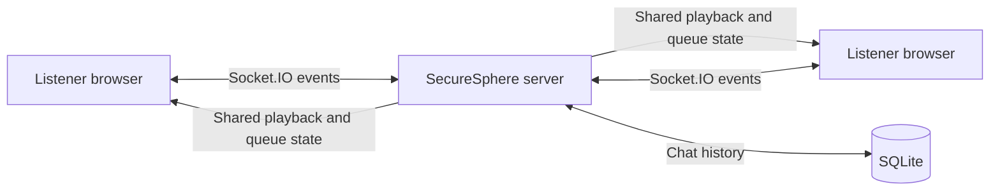

# SecureSphere - A Real Time Secure Communication

**A private listening room where friends share one live music timeline.**

SecureSphere includes the **Friends Room**, a real-time networking space built around synchronized YouTube playback, a collaborative queue, room presence, and live chat.

## Features

- **Synchronized playback** — play, pause, seek, and track changes are shared across connected listeners.
- **Collaborative queue** — add tracks to a room-wide queue and let the server advance playback.
- **Live room chat** — exchange messages in real time; chat history is stored in SQLite and sent to connecting listeners.
- **Presence and reconnection** — see how many listeners are online and request the latest room state after reconnecting.
- **Private accounts** — authenticate with username and password; an administrator can manage friend accounts.
- **Responsive interface** — polished dark and light themes, with a handwritten accent for a more personal feel.
- **Sidebar navigation** — jump between the listening room, networking overview, workflow, player, shared queue, and chat.
- **Personal room dashboard** — see your signed-in name, a live local clock and date, and the time elapsed since the first non-admin listener joined. The session timer resets when the last non-admin listener disconnects; admin connections do not keep it open.
- **Audio focus layout** — switch the YouTube player to a compact square view while keeping the official video player visible. YouTube's IFrame Player API does not offer true audio-only playback.
- **Networking and workflow visuals** — original in-page illustrations explain how listeners connect and how a room session flows.
- **Admin database exports** — administrators can download account metadata and chat history from SQLite as CSV or PDF.

## Administrator exports

The admin dashboard includes CSV and PDF downloads of the current SQLite account and chat-message records. Both export endpoints require an authenticated administrator, and generated files are marked as non-cacheable. Exports include account IDs, usernames, roles, creation times, and chat message IDs, authors, content, and timestamps. Passwords and password hashes are never exported; passwords are stored as hashes and cannot be recovered.

CSV values are quoted and escaped, and text values that could be interpreted as spreadsheet formulas are prefixed to prevent execution when opened in spreadsheet software. The PDF is a readable report; characters not supported by its built-in font are replaced with question marks. CSV preserves the original message text.

## Networking overview

Each authenticated browser connects to the Node.js room server over Socket.IO. The server maintains the active room timeline and queue, then broadcasts updates to listeners. Playback positions are reconciled against server timestamps so clients can catch up after connecting or returning to the page. Chat messages are persisted in SQLite.

## Listening session workflow

1. Friends sign in with accounts created by the room administrator.
2. A listener starts a YouTube track or adds it to the shared queue.
3. The server broadcasts playback updates and connection presence to the room.
4. Listeners chat while they listen; messages are saved in SQLite and loaded for new connections.
5. Administrators can download the current account and chat records from the admin dashboard without exposing credentials.



The live playback state, queue, and room-open timer are held in server memory. The timer starts when the first non-admin listener joins and resets when the last non-admin listener disconnects; admin connections do not start or keep the listening session open. User accounts and chat messages are stored in `data/synctune.db`; use persistent storage for `data/` when deploying to an environment with an ephemeral filesystem.

## Tech stack

- Node.js, Express, and Socket.IO
- SQLite via `better-sqlite3`
- PDF reports via PDFKit
- YouTube IFrame Player API
- HTML and CSS

## Run locally

Requires Node.js 20 or newer.

```powershell
npm install
Copy-Item .env.example .env
```

Before starting the server, edit `.env` and set a unique `JWT_SECRET`, `ADMIN_USERNAME`, and `ADMIN_PASSWORD`. The server creates the administrator account on first startup. Then run:

```powershell
npm start
```

Open `http://localhost:10000`. Sign in with the administrator credentials from `.env` to create friend accounts.

## Configuration

| Variable | Purpose |
| --- | --- |
| `PORT` | HTTP port (defaults to `10000`) |
| `JWT_SECRET` | Secret used to sign authentication tokens |
| `ADMIN_USERNAME` | Username for the initial administrator |
| `ADMIN_PASSWORD` | Password for the initial administrator |
| `ROOM_NAME` | Name displayed for the listening room |

## Deploy

The application can run as a Render Web Service:

- **Build command:** `npm install`
- **Start command:** `npm start`
- Configure the environment variables listed above.
- Attach persistent storage for the `data/` directory to retain accounts and chat history across deploys.

SecureSphere uses the official YouTube IFrame Player API. Browser autoplay policies may require each listener to interact with the player before audio can start.
